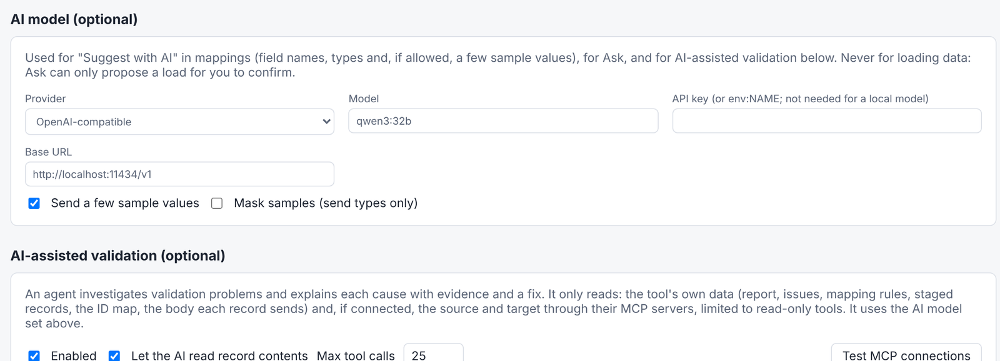
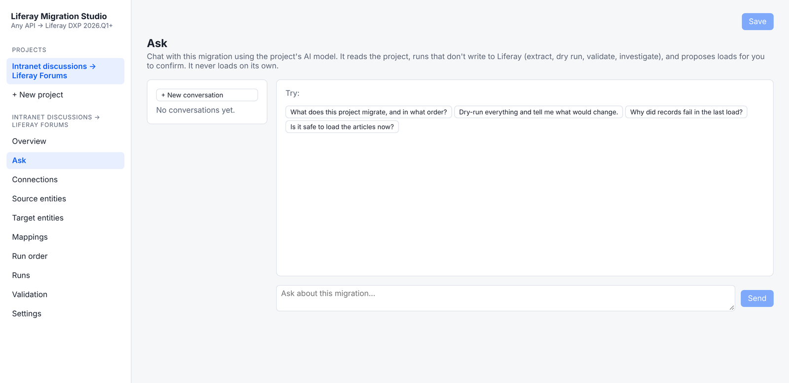

# AI Help
{: .no_toc }

{: .important }
**Preview.** The AI features are in development. Details can change before release.

1. TOC
{:toc}

**Everything in Liferay Migration Studio works without AI.** AI is off until you connect a model,
and you choose which one:

* a hosted model, through Anthropic's API or any OpenAI-compatible API, with your own key;
* or a model you run yourself (for example with Ollama, LM Studio or vLLM), which needs no key and
  keeps everything on your own infrastructure.

Set it up per project in **Settings → AI model**: the provider, the model, and either a key (written as `env:` and
an environment variable's name) or, for a model you run yourself, its address.

{: .screenshot }

## What It Does

### Suggest Field Mappings

On a mapping, **Suggest with AI** proposes which source field goes to which Liferay field, each
with a confidence and a reason. You accept or reject each suggestion; nothing changes until you do.

The model sees the field names and types of both sides. A few sample values help it match, and
you can turn them off or replace them with their type. **Suggest (no AI)** matches names and
types without any model.

### Explain Validation Problems

When validation finds problems, **Investigate with AI** looks at the records involved and reports
one finding per cause: the affected records, the evidence, a suggested fix and how confident it
is. For example: *"12 articles failed because their structure wasn't migrated: the structures
mapping is turned off."*

It can also read the source and target Liferay through their MCP servers: the Liferay Legacy MCP
server for 2024.Q1 to 2025.Q4, and Liferay DXP 2026.Q1+'s own MCP server.

### Ask About a Migration

**Ask** is a chat about the open project: *"Is it safe to load the articles now?"*, *"Why did
records fail in the last load?"*

* It can read the project and its runs, reports and issues.
* It can start runs that don't write to Liferay: extract, dry run, validate and investigate.
* It **can't load**. It can only propose a load, which runs when you click **Run it**.

{: .screenshot }

## What the AI Can't Do

* **Write to Liferay.** The AI only gets read-only tools. Tools from MCP servers are offered only
  if they're read-only, and the rest are blocked and listed in Settings. On Liferay's own MCP
  server, only read operations are let through.
* **Load from the chat.** In Ask, a load always needs a person to confirm it.
* **See records you don't want it to see.** With **Let the AI read record contents** turned off,
  the investigation and Ask tools show the AI counts, messages and mapping rules, but no record
  contents.
* **Receive bulk data.** The model works with summaries and individual records it asks for.
  Migrated data never passes through it.

## What's Been Tested

**Ask** and **AI-assisted validation** have been tested end to end with a scripted model standing in for a real
one: the tools they offer, the read-only limits, refused writes, and proposals that need confirming. AI-assisted
validation has also run against the live MCP servers of Liferay 2025.Q1 and 2026.Q3. **Suggest (no AI)** is
tested; **Suggest with AI** hasn't been tested with a model yet. Testing with real models is next, before release.

## Use Your Own AI Assistant

Studio includes an MCP server, so Claude or another MCP client can work with migrations from your
own assistant: list projects, check run status, start runs and read validation reports. Runs it
starts are dry runs unless it asks for a real load, and assistants such as Claude ask you before
running a tool that can write. On a server it uses the same access token as the web UI.
