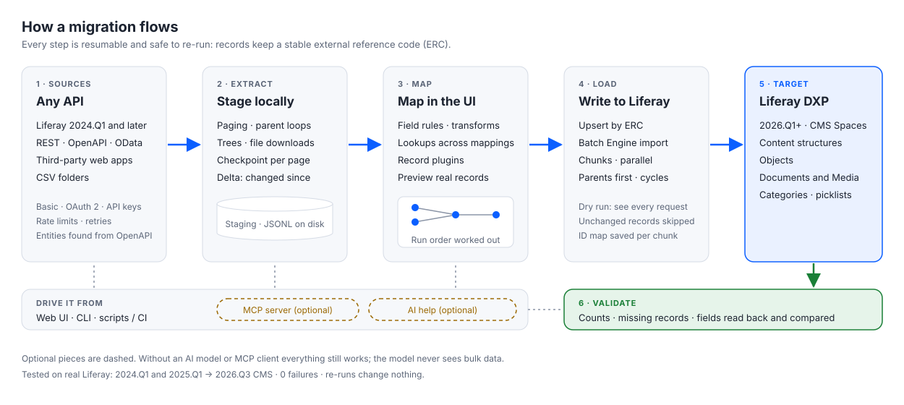
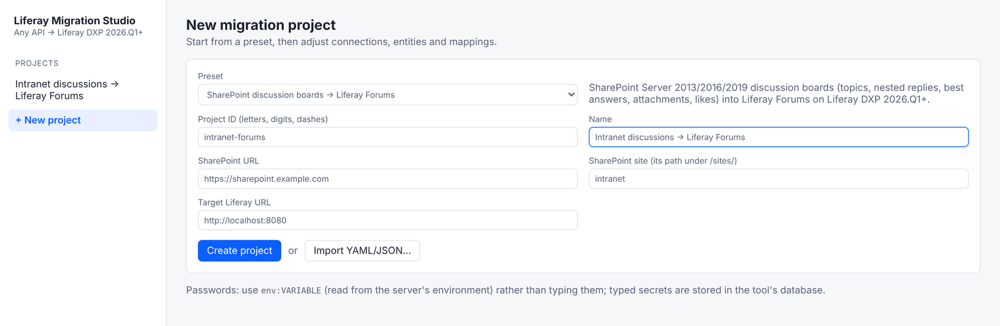
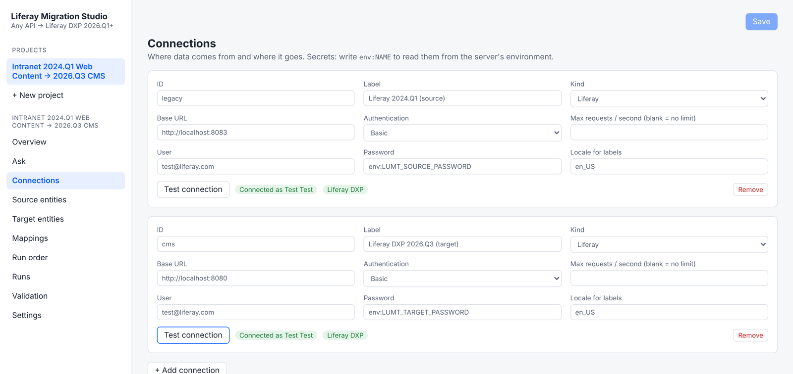
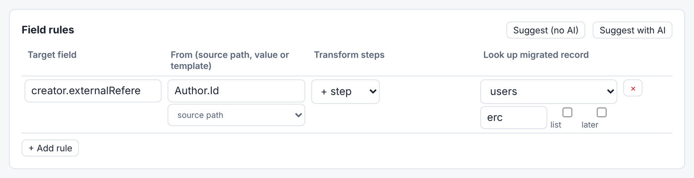
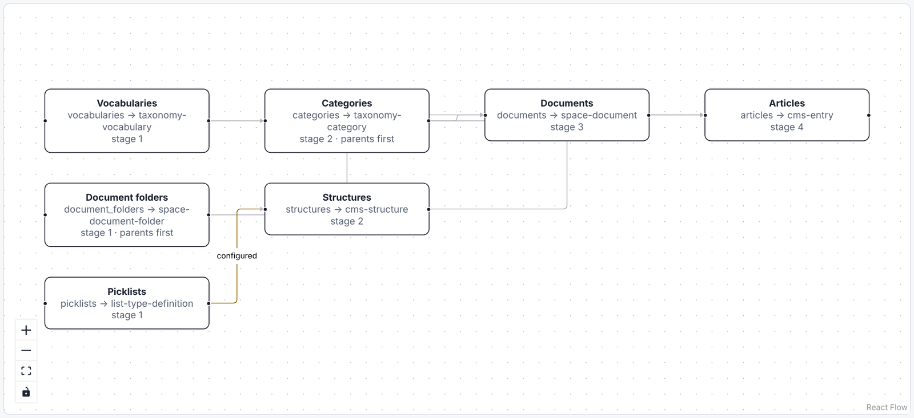
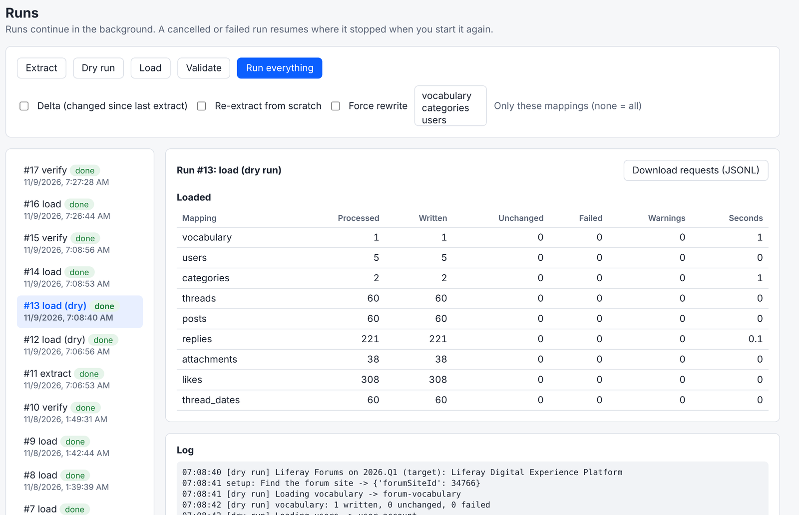
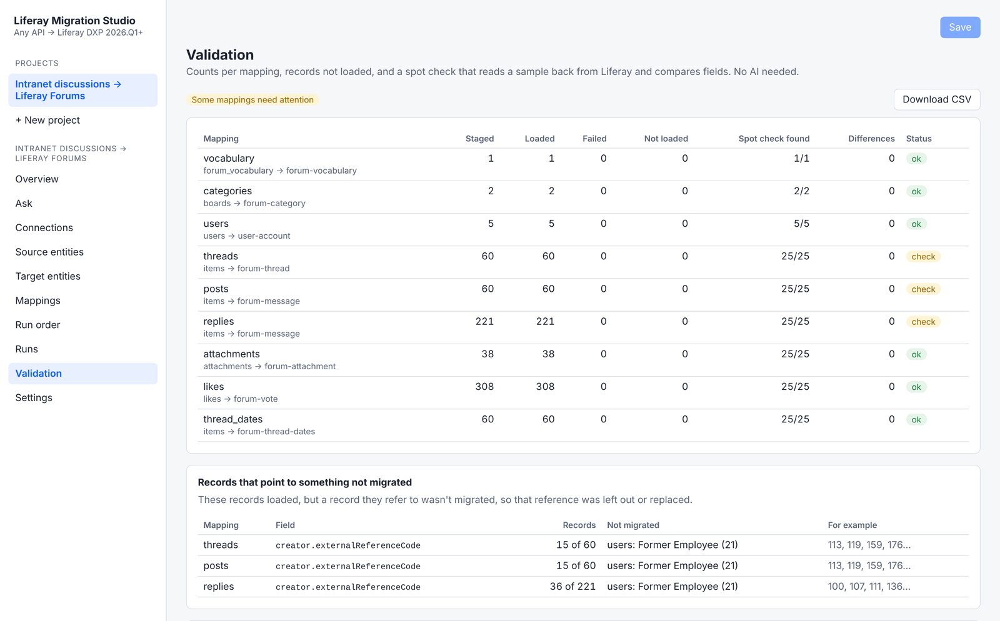

# How It Works
{: .no_toc }

{: .important }
**Preview.** Liferay Migration Studio is in development. Details can change before release.

1. TOC
{:toc}

A migration is a **project**: where the data comes from, where it goes in Liferay, and how each field maps. You
build it in the web UI, or start from a ready-made project for a common migration and adjust it. Everything in a
project is ordinary configuration you can change, and a project can be exported and imported as a file.

## Create a Project

Click **New project** and pick a starting point:

| Starting point | What you get |
| --- | --- |
| **Liferay Web Content (7.3+) → 2026.Q3 CMS** | Connections, entities and mappings for classic Web Content into a CMS Space. See [Liferay Web Content to the New CMS](liferay-web-content-to-cms.html). |
| **Whole Liferay site (7.3+) → 2026.Q3 CMS** | Everything above, plus users, roles and organizations, original authors, folders, comments, permissions, templates, blogs, knowledge base, wiki and message boards. See [A Whole Liferay Site to the New CMS](liferay-site-to-cms.html). |
| **SharePoint discussion boards → Liferay Forums** | Discussions, replies, authors, attachments and likes into Liferay Forums. See [SharePoint Discussions to Liferay Forums](sharepoint-discussions-to-forums.html). |
| **Blank project** | Nothing yet: add your own connections, entities and mappings. |

The form asks only what the starting point needs, such as the SharePoint server and site, or the source Liferay's
site.

{: .screenshot }

## Connect

A **connection** is a system's address and how to sign in to it: Basic, OAuth 2 client credentials, an API key, a
bearer token, or NTLM for SharePoint Server on premises. Each connection can have a request rate limit, so a
production source isn't overloaded.

Write passwords and keys as `env:` followed by the name of an environment variable on the Migration Studio server,
such as `env:LUMT_SOURCE_PASSWORD`. The project then never holds the secret itself.

**Test connection** signs in and, for Liferay, shows which edition the server is. Loads go into **Liferay DXP**
only; a Liferay Community Edition target is refused.

{: .screenshot }

## Extract

**Extract** reads every source record and stages it on Migration Studio's own disk before anything is written. It
handles:

- **paged APIs**: page numbers, offsets, cursors and next links;
- **nested collections**, such as the categories of each vocabulary or the replies of each discussion;
- **trees**, such as nested folders and categories;
- **files**: each document or attachment is downloaded once. If a server answers with a web page instead of the
  file, as some do for signed-out requests, Migration Studio uses the source's API to fetch the file instead.

Extraction saves its progress after every page, so it resumes where it stopped. At cutover, a **delta** extract
reads only what changed since the last extract.

## Map

A **mapping** sends one kind of source record (articles, say) to one kind of Liferay record (CMS entries). Its
**field rules** say how each target field is filled:

- **copy** a source field, set a **fixed value**, or build one from a **template**;
- **transform** it with steps: dates, text, numbers, lists, value lookups, localized values, stripping HTML;
- **look up a migrated record** and use its new ID, external reference code or URL, such as a reply's author or an
  article's categories.

{: .screenshot }

A mapping can also filter which records it migrates, and set how many records it sends in parallel and per chunk.
For shapes that rules can't express, such as one article becoming one entry with fields from its structure, a
ready-made project uses a **record plugin** that builds the whole body.

**Preview with staged records** shows the exact request a mapping would send for real records, before any load.

**Suggest (no AI)** proposes field rules by matching names and types. With an AI model connected, **Suggest with
AI** does the same with the model's help. See [AI Help](ai.html).

## Run Order, Worked Out for You

Mappings that look up records of another mapping run after it. Migration Studio works the order out from the
mappings themselves:

- vocabularies before categories, and folders before documents;
- structures and documents before the articles that use them;
- users before the posts they wrote;
- within a tree, such as nested categories or replies to replies, parents before their children.

Mappings in the same stage don't depend on each other. If two mappings need each other, one reference is written in
a second pass at the end.

{: .screenshot }

You can add a dependency by dragging from one mapping to another, or pin an order. Migration Studio warns if a pin
contradicts a dependency.

## Dry Run

A **dry run** prepares every request the load would send, in the right order, and writes nothing. It shows how many
records each mapping would write and whether any would fail, and **Download requests** gives you every request as a
file to review.

{: .screenshot }

## Load

The **load** writes to Liferay in chunks, several requests at a time:

- **Re-runs are safe.** Every migrated record gets a stable external reference code, so running a load again
  updates records instead of duplicating them.
- **Unchanged records are skipped.** A record that's the same as last time isn't sent again, so a second load of a
  finished migration writes nothing.
- **It can stop and resume.** Cancel a load, or let it fail, and start it again: it carries on.
- **Large imports** can use Liferay's batch import, which also keeps each record's original author.
- **Retries:** a busy or failing server is retried for requests that are safe to repeat; nothing that could create a
  duplicate is retried.

At cutover, a **delta** extract followed by a load writes only what changed since the first migration.

## Validate

**Validate** compares the migration with the source:

- **counts** per mapping: staged, loaded, failed and not loaded;
- a **spot check**: a sample of migrated records is read back from Liferay and compared field by field with what was
  sent, including nested fields such as the author, with dates compared by value;
- **records that point to something not migrated**: for example, forum posts whose author wasn't imported, with the
  missing record named;
- **fields Liferay didn't keep**: a field that comes back different in nearly every record checked isn't a bad
  record. Liferay sets it itself, as with a forum post's creation date, which is always the time of the import.

{: .screenshot }

Every problem lists the records involved, and a CSV of the report can be downloaded. With an AI model connected,
**Investigate with AI** explains the causes. See [AI Help](ai.html).

## Keep Fields Liferay Doesn't Keep

When validation lists **fields Liferay didn't keep**, **Keep these values** repairs them after the load:

1. **An individual update.** Migration Studio updates the field on one record on its own, after the load, and reads
   it back. If Liferay keeps it this way, every record is updated the same way.
1. **A custom field.** If Liferay still sets its own value, Migration Studio adds a custom field to the Liferay object
   behind the target, such as `originalDateCreated`, typed from the value (a date and time, a number, text), and
   writes every record's value into it.

The project remembers it: later loads, including delta loads at cutover, write the custom field directly, and
validation checks the custom field instead. Adding a field changes the Liferay object, so the repair runs only when you
start it, and a **dry run** shows what it would do first.

Tested on Liferay Forums: Liferay ignores a post's creation date in the batch import and in individual updates, so
the repair added `originalDateCreated` to the forum's topics and messages and kept all 341 SharePoint dates there.

## Ways to Drive It

- The **web UI**, for everything above.
- The **command line**, for scripts and scheduled cutover runs: extract, dry run, load, validate and status.
- An **MCP server**, so Claude or another AI assistant can check status, start runs and read reports. See
  [AI Help](ai.html).
