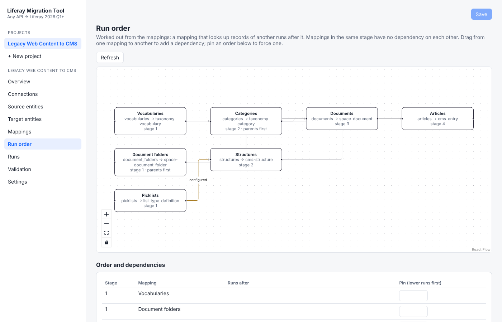

# Liferay Migration Studio
{: .no_toc }

{: .important }
**Coming soon.** This page describes a tool in development. There's nothing to download yet.

1. TOC
{:toc}

Move content from systems with an API into **Liferay DXP**. You map the source to Liferay in a
web UI, check every request with a dry run, load, then validate the result against the source.
Loads can be stopped and re-run without creating duplicates.

## First example: Liferay 2024.Q1 Web Content → the new CMS in 2026.Q3

Liferay 2026.Q3 introduces a new CMS built on Spaces. Migration Studio moves classic Web Content
into it:

| From Liferay 2024.Q1 | To Liferay 2026.Q3 |
|---|---|
| Web content structures | CMS content structures |
| Web content articles, with their translations | CMS entries |
| Select, radio and multi-select options | Picklists |
| Documents and Media folders and files | Space documents and folders |
| Vocabularies and categories, including nested ones | Vocabularies and categories |

Images and links inside article text are rewritten to point at the migrated documents.

**Tested on real Liferay, from `2024.q1.32` to `2026.q3.9`** (a sandbox with sample content):

* All 200 sample articles (English and Spanish), 14 documents, 3 structures and a 3-level
  category tree loaded on the first run, with no errors.
* Validation read 100 migrated articles back from Liferay and compared them with the source:
  no differences.
* Running the load again changed nothing.

Liferay 2025.Q1 has been tested the same way. See
[the migration guide](liferay-web-content-to-cms.html) for what's migrated and what isn't.

## How it works

1. **Connect** the source and your Liferay DXP.
2. **Map** what goes where: entities, fields and transformations, in the UI. Ready-made
   mappings cover the example above.
3. **Run order is worked out for you.** Vocabularies come before categories, parent categories
   before their children, documents before the articles that use them. You can change the order
   in the UI.

   {: .screenshot }

4. **Dry run.** Every request the load would make, with nothing written.
5. **Load.** Handles large volumes in parallel batches. It can be stopped and resumed, and a
   delta load at cutover writes only what changed.
6. **Validate.** Record counts, plus a field-by-field comparison of a sample of migrated
   records against the source.

## Optional AI help

Everything works without AI. With an AI model of your choice (a hosted service or a model you
run yourself), Migration Studio can:

* suggest field mappings for you to accept or reject,
* explain why records failed validation, with evidence,
* answer questions about a migration in a chat. It can run checks and dry runs, but only
  proposes loads for you to confirm.

## In These Docs

* [How it works](how-it-works.html): connect, extract, map, run order, dry run, load, validate
* [Liferay Web Content → the new CMS](liferay-web-content-to-cms.html): what's migrated, field
  types, what isn't, and the before and after checklist
* [AI help](ai.html): mapping suggestions, explaining validation problems, and Ask
* [Security and data](security-and-data.html): where it runs, where data goes, safeguards

## Planned sources

* Liferay Web Content from 2024.Q1 and later (above)
* SharePoint discussion boards → Liferay Forums
* Other systems through their REST API, or CSV files

## Requirements

* **Liferay DXP** 2026.Q1 or later as the target. Liferay Community Edition isn't supported.
* Docker, on a laptop or a server.
