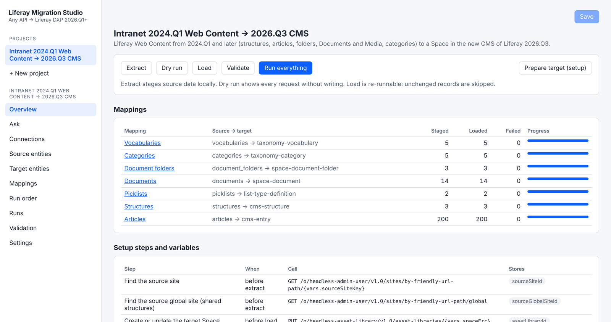
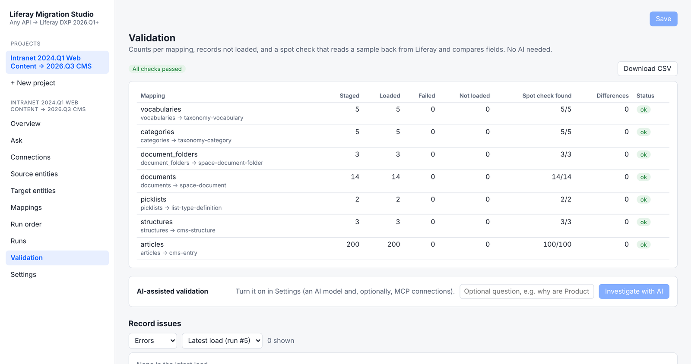
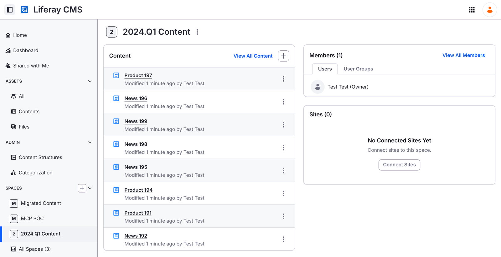
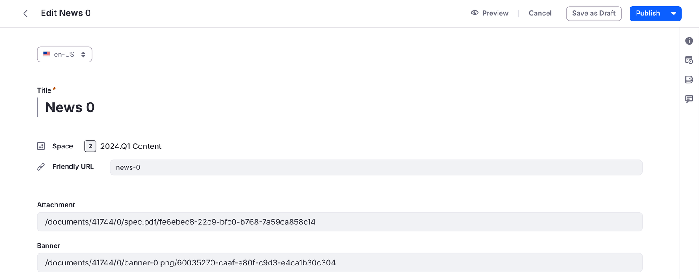
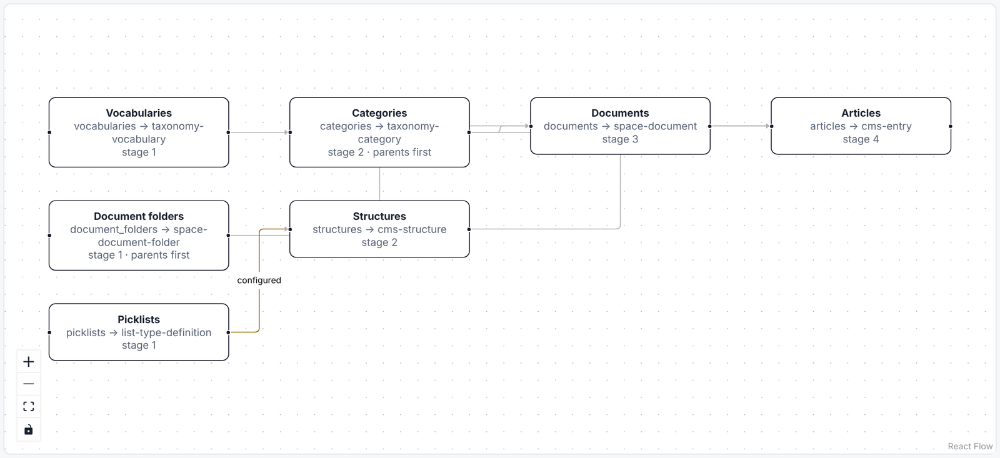

# Liferay Web Content to the New CMS
{: .no_toc }

{: .important }
**Preview.** Liferay Migration Studio is in development. Details can change before release.

1. TOC
{:toc}

This ready-made migration moves one site's classic Web Content from **Liferay DXP 7.3 or later**
into a **Space** of the new CMS in **Liferay DXP 2026.Q1 or later**. Everything in it is ordinary
project configuration, so you can change any part of it in the UI.

{: .screenshot }

## Tested

On real Liferay, from `liferay/dxp:2024.q1.32` to `liferay/dxp:2026.q3.9`, with sample content:

| | Loaded | Read back and compared |
|---|---|---|
| Articles (English and Spanish) | 200 of 200 | 100, no differences |
| Documents | 14 of 14 | |
| Structures | 3 of 3 | |
| Categories (3 levels) | 5 of 5 | |

There were no errors on the first load, and running it again changed nothing. The same migration
from `liferay/dxp:2025.q1.29-lts`, with 339 articles, gave the same result, and a delta load wrote
only the articles added or changed since the first load. From `liferay/dxp:7.3.10-u36` (DXP 7.3), 202 of 202
articles, 14 documents and 5 structures loaded with no errors, and the spot check of 100 articles found no
differences.

{: .note }
DXP 7.3 returns image, document and related-article fields in an older form than 7.4 and later. Migration Studio
reads both, and warns if a field holds a value it can't read, so a field is never left empty without a warning.

{: .screenshot }

{: .note }
Checking the migrated files in Liferay's CMS found two problems the first test didn't, and both are now fixed. On
2024.Q1, the source served some files as a web page instead of the file, so seven images arrived as HTML: files
that come back as a web page are now fetched through the API instead. And links to migrated files named one
version of the file, so a replaced file wasn't shown: links now always serve the file's latest version.

## The Result in Liferay's CMS

The migration creates the Space, here *2024.Q1 Content*, and its entries appear under **Content** like any other
CMS content.

{: .screenshot }

Each entry keeps its title and translations, its field values, and links to its migrated images and documents.

{: .screenshot }

## What's Migrated

| From Web Content | To the new CMS | |
|---|---|---|
| Vocabularies and categories | Vocabularies and categories | Nested categories keep their tree. Vocabularies the target already has, such as *Topic*, are reused, not duplicated. |
| Documents and Media folders and files | The Space's document library | Reachable by their links. The CMS **Files** view doesn't list them yet (see below). |
| Select, radio and multi-select options | Picklists | One per field. |
| Web content structures | CMS content structures | Field by field (see below). Site and global structures. |
| Articles | CMS entries | Every translation. Categories and keywords. |

**Run order:** vocabularies, document folders and picklists first; then categories and
structures; then documents; then articles, which need all of them.

{: .screenshot }

Images and links inside article text are rewritten to point at the migrated Space documents.

## Field Types

| Web content field | CMS field |
|---|---|
| Text, text box | Long text |
| Rich text | Rich text, with migrated image and document links rewritten |
| Select, radio | Picklist |
| Multi-select, checkboxes | Multi-select picklist |
| A single checkbox (yes/no) | Boolean |
| Integer, decimal | Integer, decimal |
| Date, date and time | Date, date and time |
| Image, document | Text: the URL of the migrated Space document |
| Link to another article | Text: the migrated entry's external reference code |
| Link to a page, geolocation | Text |
| Fieldset | Its fields, flattened |
| Repeatable field or fieldset | Long text, as JSON |

Each structure also gets the article's original ID, friendly URL, folder, author and dates, in
fields starting with `legacy`, so nothing is lost and redirects can be built later.

### Why Some Fields Become Text

* **Images and documents:** 2026.Q3's API doesn't yet accept attachment values for CMS entries.
  The files are uploaded to the Space, and the field holds their new URL.
* **Links to other articles:** kept as the migrated entry's reference code, so they can become
  relationships later.
* **Repeatable fields:** kept as JSON until filling CMS repeatable groups through the API is
  confirmed.

## Known Limitations

* **Migrated files don't appear in the CMS Files view yet.** They're uploaded to the Space's document library, so
  every image, document field and link in the migrated entries opens them, but the CMS lists only files created as
  CMS Files. Creating them as CMS Files, which the 2026.Q3 API accepts, is planned before release.
* **The images and documents in field values are links**, not CMS attachments (see above).

## Not Migrated

* **Templates** (FTL) and ADTs. Rebuild them as display page templates or fragments.
* **Version history and drafts.** Only the latest approved version of each article.
* **Original author and dates** as the entry's own. The CMS sets them at migration time; the
  originals are kept in the `legacy` fields.
* **Friendly URLs** as the entry's own. They're kept in a `legacy` field for redirects.
* **Permissions.** Grant VIEW on the migrated content structures after loading.
* **Comments, ratings and related assets.**

## Before and After Loading

**Before:**

* Turn off email notifications and subscriptions on the target, and workflow for CMS structures,
  so migrated entries don't notify users or wait for approval.
* Do a dry run and review it.

**After:**

* Grant VIEW on each migrated content structure (CMS → Admin → Content Structures → Permissions).
  Custom structures have it turned off by default.
* Run validation.
* At cutover, run a delta extract and load to pick up what changed since the first load.

## Large Sites

Documents and articles load in parallel; you can raise or lower that per mapping. On a production
source, set a request rate limit on the connection.
