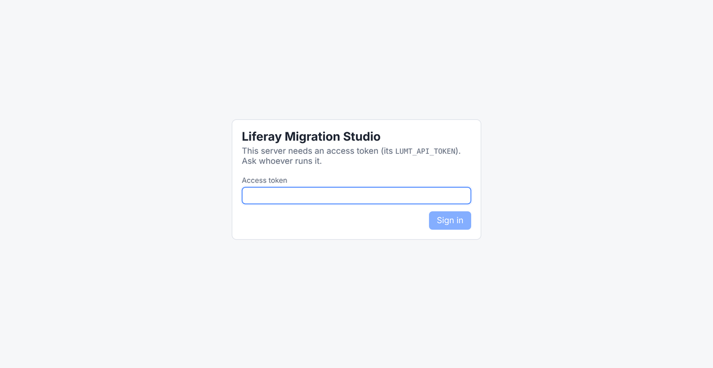

# Security and data
{: .no_toc }

{: .important }
**Preview.** Liferay Migration Studio is in development. Details can change before release.

1. TOC
{:toc}

## Where It Runs

Liferay Migration Studio is a Docker container that runs on your own infrastructure: a laptop
for one person, or a server for a team. There's no hosted service and nothing to sign up for.

## Where Your Data Goes

* **Only to the systems you connect.** Studio reads from the source connections and writes to
  the Liferay DXP target. It makes no other connections, apart from the AI model if you set one up.
* **AI is off until you connect a model.** If you use a model you run yourself, nothing leaves
  your network. See [AI help](ai.html) for what a model can see.
* **Staged data stays with Studio.** Records and files read from the source are kept on Studio's
  own disk, and its project data in its database (built in, or PostgreSQL on a server).
  Deleting a project removes both.

## Credentials

* Keep passwords and keys in **environment variables** on the server, and refer to them by name
  in a project, such as `env:LUMT_TARGET_PASSWORD`. Exporting or sharing the project then never includes them.
* Give the source connection read access only. The target connection needs to write only the
  content being migrated.

## Access

* On a laptop, Studio listens only on your own machine.
* On a server, an **access token** protects the web UI, the API and the MCP server. Studio warns
  if it's reachable on a network without one. Put HTTPS in front of it.

{: .screenshot }

## Safeguards

* **Dry runs** show every request a load would send, without writing anything.
* **The built-in AI chat can't load.** It can only propose a load, which runs when a person
  confirms it.
* **AI assistants connected over MCP start dry runs by default.** A real load has to be asked
  for explicitly, and assistants such as Claude ask you before running a tool that can write.
* **Re-runs are safe.** Every migrated record has a stable external reference code, so running a
  load again updates records instead of duplicating them.
* **Liferay DXP only.** Studio checks the target before loading and refuses Liferay Community
  Edition.
* **The container runs as an unprivileged user.**
