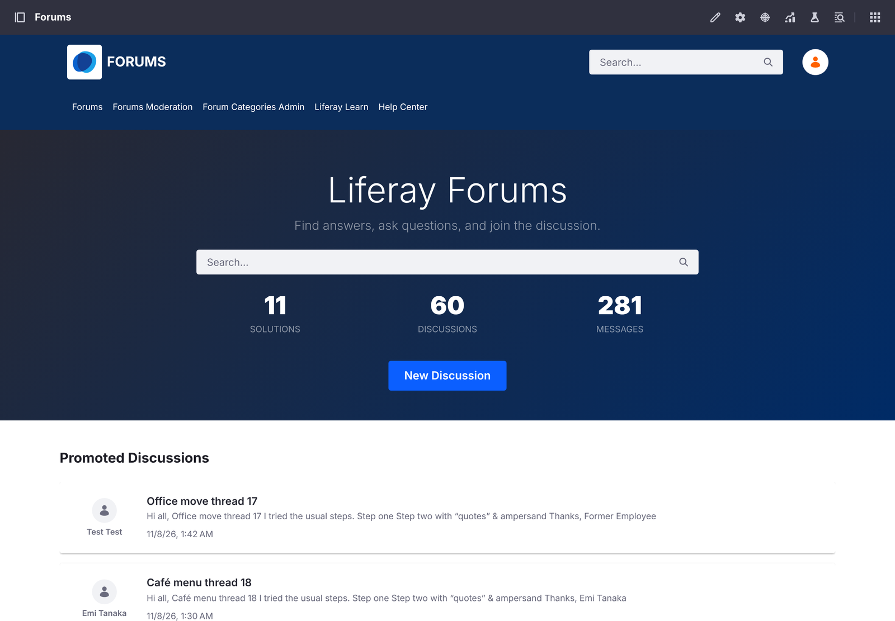
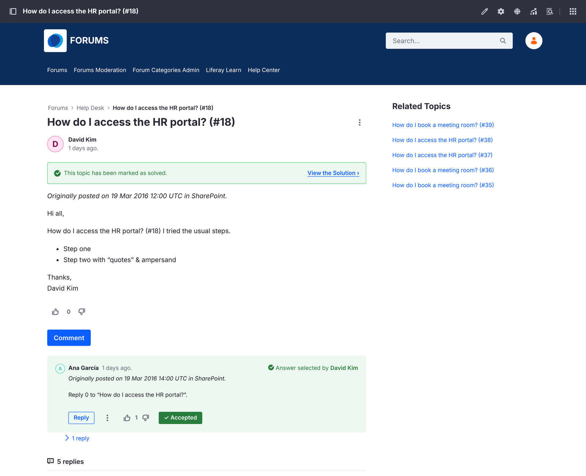

# SharePoint Discussions to Liferay Forums
{: .no_toc }

{: .important }
**Preview.** Liferay Migration Studio is in development. This migration has been tested against a simulated
SharePoint Server 2016, not yet a real farm.

1. TOC
{:toc}

This ready-made migration moves SharePoint Server discussion boards into
[Liferay Forums](/liferay-forums/) on Liferay DXP 2026.Q1 or later: every discussion, reply and reply to a reply,
with its original author, best answer, attachments and likes.

{: .screenshot }

## Tested

Liferay Forums 1.0.0 on Liferay DXP 2026.Q1.4 LTS with PostgreSQL, against a simulated SharePoint Server 2016 REST
API built from SharePoint's documented conventions:

| | Loaded |
| --- | --- |
| Discussion boards → forum categories | 2 of 2 |
| Users | 5 of 5 (the sixth has no email address) |
| Discussions → topics, with their original posts | 60 of 60 |
| Replies, nested up to three levels | 221 of 221 |
| Attachments | 38 of 38 |
| Likes → votes | 308 of 308 |

There were no errors, the forum accepted every post, and running the load again changed nothing. Every post kept its
SharePoint author, except the 15 discussions and 36 replies by a user without an email address, which validation listed.

## What's Migrated

| SharePoint | Liferay Forums |
| --- | --- |
| Discussion board | Forum category (an existing category of the same name is reused) |
| Discussion | Topic, with its original post |
| Question with a best answer | Topic marked solved, with that reply as the accepted answer |
| Reply, and reply to a reply | Message, nested under the message it answers |
| Attachment | Attachment on the post or reply |
| Like | A vote by the user who liked it |
| Site user with an email address | Liferay user, kept as the author of their posts and votes |
| Last updated | The topic's last post date |
| Created | `originalDateCreated`, a custom field added to topics and messages (see below) |

Posts keep their formatting. Each post starts with *Originally posted on* and its SharePoint date, because Liferay
sets a migrated post's own date to the time of the migration.

{: .screenshot }

## How It Loads

Users are imported first, then categories, topics, original posts and replies, and finally attachments, likes and
last post dates. Replies wait for the message they answer, so every reply is nested correctly.

Topics, posts, replies and likes are loaded with Liferay's batch import, which keeps each one's original author:
Liferay's regular API would record the migration account as the author of everything.

Liferay Forums' microservice checks every new message, so it must be running during the load.

## Before You Start

- Install Liferay Forums, create its forum site, and start its microservice, as the
  [Liferay Forums guide](/liferay-forums/) describes.
- Use a SharePoint account that can read the site. SharePoint Server on premises usually needs **NTLM**
  authentication, with the user as `DOMAIN\user`.
- Check that SharePoint's site users have email addresses: users without one aren't migrated, and their posts are
  posted by the migration account.
- Turn off email notifications on the forum's Liferay until the migration is done, so subscribers aren't emailed
  about every migrated post.

## Original Dates

Liferay sets every topic's and message's creation date to the time of the import: it ignores SharePoint's date in
the batch import and in individual updates. Validation reports this as a field Liferay didn't keep, and **Keep
these values** adds a custom field, `originalDateCreated`, to the forum's topics and messages and keeps every
SharePoint date there. Liferay Forums' pages still show Liferay's own date, so each post also starts with
*Originally posted on* and its SharePoint date.

## Not Migrated

- **Users without an email address,** and their likes.
- **Star ratings, Featured discussions, alerts and subscriptions.**

Migrated users have no password: they sign in with your single sign-on, or reset their password.
